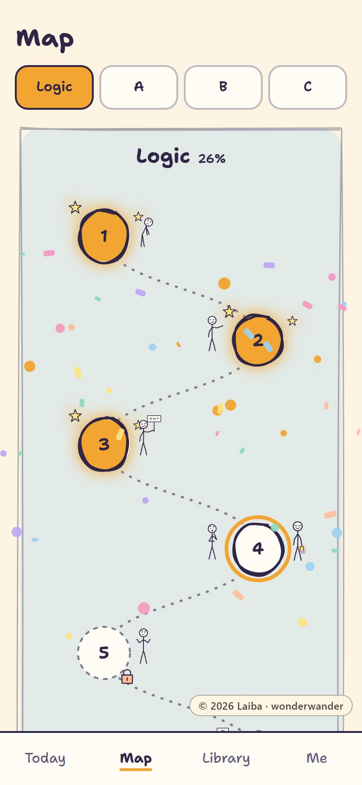
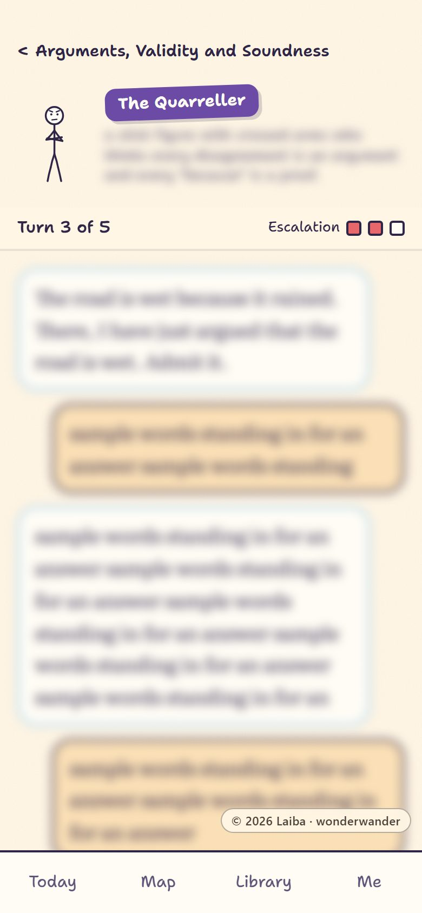
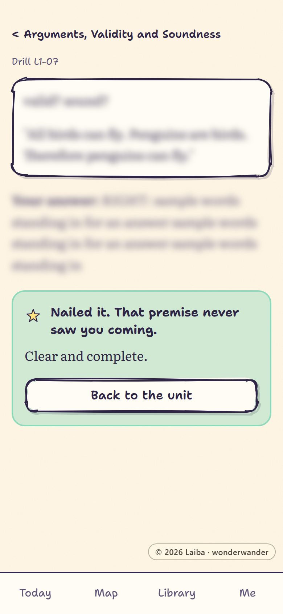
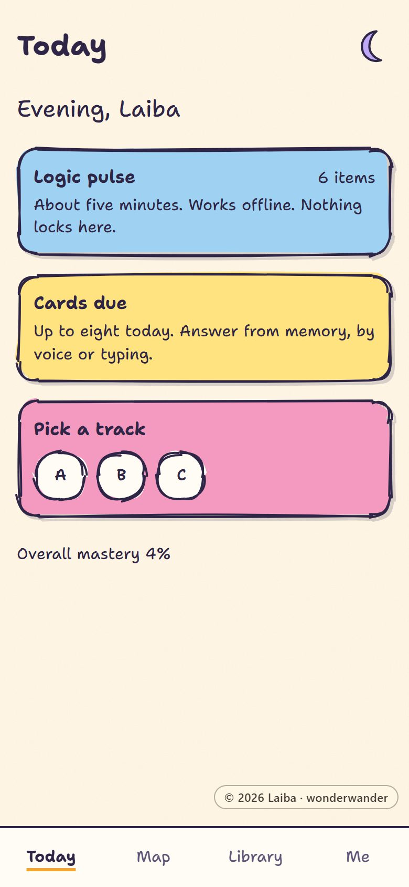
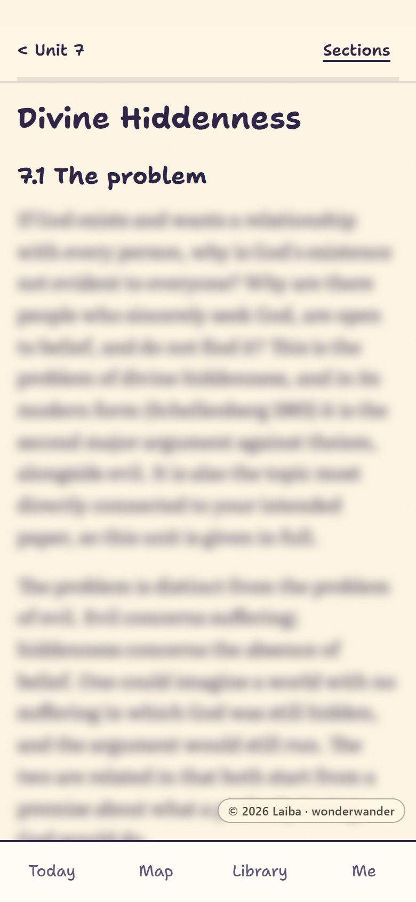
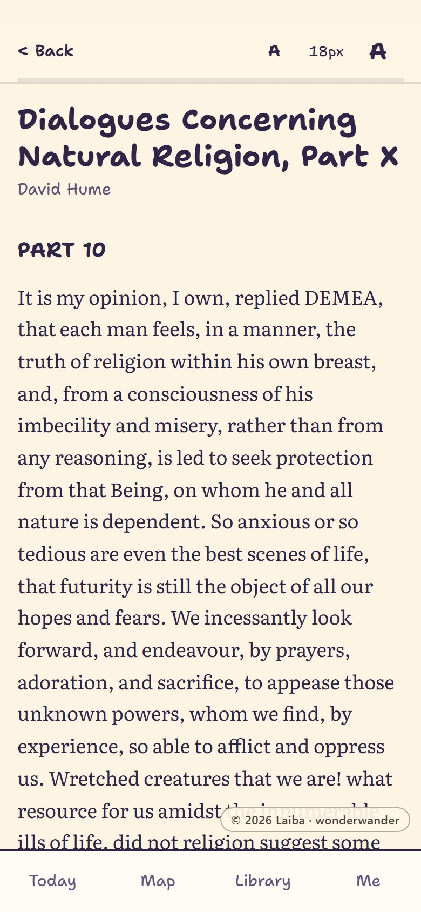
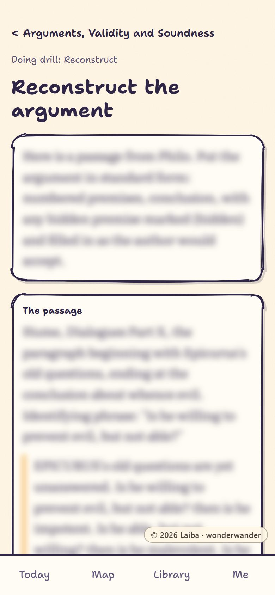
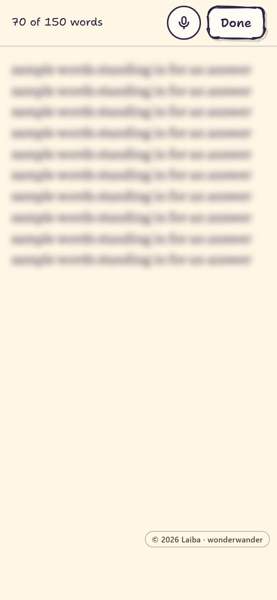
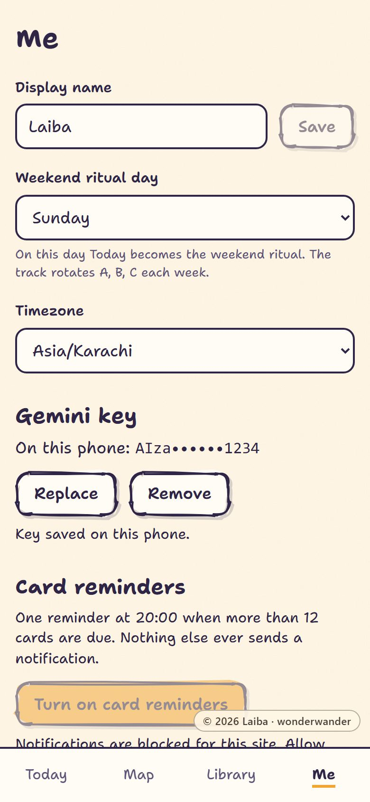

# wonderwander

**A philosophy gym that trains you to argue, not just to read.**

  
  
  

## What it does

wonderwander is a course in philosophy that you work through on your phone. Seven domains (logic, epistemology, metaphysics, mind, religion, religious epistemology and political philosophy) hold 56 units, studied in order. Each unit gives you a lesson and then makes you use it:

- **drills** that ask you to define, distinguish and diagnose, in your own words;
- **move-cards** on spaced repetition, so the moves of argument stay with you;
- **readings** from the primary texts, with comprehension questions;
- **reconstruct, object, reply**: put a real argument into standard form, attack a premise, then answer the author's best defence;
- **a boss fight** to finish every unit: a debate against an opponent who holds the position and knows the standard objections;
- **a writing ladder** from abstract to short paper, refereed against a checklist.

Nothing is passive. You answer by typing or by voice, and a failed item rests until midnight while you revise it; the rest of the unit stays open.

## How it grades

Every written answer is checked twice, with your own free Gemini key. A grader compares it with the authored answer key, element by element; an independent auditor re-derives the verdict without deferring to the grader. When the two agree, the result stands. When they disagree, or the grader is unsure, you get one soft retry, or a second run settles it. Bosses face a judge with a rubric and a second judge for close calls; papers are refereed twice.

It is honest about its limits. A language model can tell whether your answer contains what the key requires, whether you attacked a premise or only the conclusion, and whether you strawmanned the opponent. It cannot tell you whether your view is true, and it is never asked to. Close calls are marked appealable, so a verdict you think is wrong can go to a second opinion.

  
  
  

  
  
  

Today; a lesson; the reader; the reconstruct builder; the writing editor with the mic; Settings.

## Who it is for

Anyone who wants to get good at philosophy rather than read about it: a student preparing for a degree or a first paper, or anyone who has read the introductions and wants to be made to do the work. It is built around fifteen minutes a day, with a longer session of about an hour at the weekend, and there are no streaks to keep.

**What it is not:** a video course, a chatbot to talk philosophy with, or a note-taking app. The teaching is all in the authored curriculum; the model plays the opponents it describes and checks your answers against it.

## Get it

- **The hosted copy** at [laiba-121921.github.io/wonderwander](https://laiba-121921.github.io/wonderwander/) is by invitation. Install it from Chrome on Android ("Add to Home screen"); after the first download it works offline.
- **Run your own** on free accounts by following [docs/SELF_HOST.md](docs/SELF_HOST.md). It takes about twenty minutes.

## The curriculum

The curriculum was written by Laiba and is licensed under [CC BY-NC-SA 4.0](https://creativecommons.org/licenses/by-nc-sa/4.0/). It is not in this repository; the app downloads it as a content pack after sign-in. It is available from the author on request. To teach something else, write your own pack: [docs/CONTENT_PACK.md](docs/CONTENT_PACK.md) describes the format.

## Built with

React and TypeScript on Vite, styled with Tailwind, installed as a PWA that works offline; Supabase for sign-in, Postgres with row level security, storage, edge functions and scheduled reminders; Google's Gemini API on its free tier, under each person's own key; FSRS for spaced repetition; mammoth and pdf.js to read uploaded drafts on the phone; Vitest and Playwright for tests. It runs on free tiers only. [docs/ARCHITECTURE.md](docs/ARCHITECTURE.md) explains how it fits together.

The readings and references lean on open-access sources: the Stanford Encyclopedia of Philosophy, the Internet Encyclopedia of Philosophy, Project Gutenberg, forall x, and the many philosophers who make their papers freely available.

## Licence and attribution

Curriculum written by Laiba, 2026. App designed and built by Laiba.

- **Code:** MIT licence, copyright 2026 Laiba ([LICENSE](LICENSE)).
- **Curriculum:** CC BY-NC-SA 4.0, copyright 2026 Laiba, distributed separately.
- **Screenshots:** copyright 2026 Laiba. They show the curriculum with its text blurred.
- **Bundled readings:** public domain, from Project Gutenberg.
